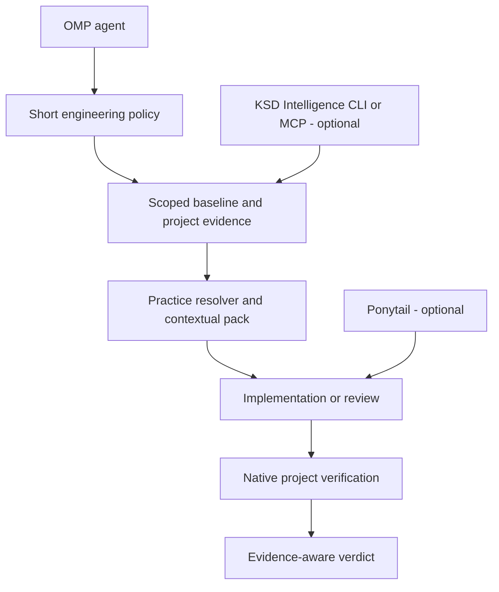

# erosiano-dev

**Baseline-driven engineering guidance for [Oh My Pi (OMP)](https://github.com/can1357/oh-my-pi).**

Understand the project before changing it. Follow its architecture and contracts before imposing personal preferences. Select the practices that matter, then verify the work with real evidence.

[](https://github.com/Krisada-M/ksd-engineering/actions/workflows/tests.yml)
[](LICENSE)

**Development candidate:** package and marketplace metadata remain at **0.7.0**. The v1.0 engineering roadmap is implemented in stages; release acceptance is not yet complete. See [verification and limitations](#verification-and-limitations). This is the successor to Engineering Proxy, not an additional policy plugin to install alongside it.

## What it does

- A compact, cached engineering policy in ordinary agent turns; detailed baseline discovery, contextual practice selection and SDLC review on demand.
- 138 versioned practices in 12 categories, resolved against observed task/project context, confidence, project conventions, and required safety/native gates.
- Bounded read-only evidence sampling and fingerprinting, optional evidence-bound policy packs, and explicit unknown/conflict reporting.
- Optional TypeScript-aware ESLint, compiler profiles, changed-line diagnostics and evidence-aware review verdicts.
- Compatible with independent Ponytail simplification guidance and optional KSD Intelligence CLI/direct MCP evidence.
- Zero required runtime npm dependencies. No automatic repository rewrite, dependency installation, test execution, tool activation, external LLM request, merge or deployment.

| Component | Responsibility |
|---|---|
| OMP | Agent orchestration, tools, approvals and session permissions |
| erosiano-dev | Project baseline, engineering practices, quality and evidence guidance |
| Ponytail (optional) | Simplicity, YAGNI and its own review/modes |
| KSD Intelligence (optional) | Code navigation, dependency impact and changed-symbol evidence |
| Host project | Architecture, contracts, formatter/linter, compiler, tests, security invariants and CI |



The extension supplies guidance rather than a mandatory orchestrator or a security boundary. The agent must actually inspect the repository and execute permitted checks.

## Quick start

Requires a compatible OMP installation; live CI pins **OMP 19.2.1** on Linux and macOS. Optional standalone JavaScript companions support Node.js >=20; development CI uses Node 22.13 and 24.

New installation from the repository marketplace:

```bash
omp plugin marketplace add Krisada-M/ksd-engineering
omp plugin install erosiano-dev@erosiano-dev
omp plugin list
```

Restart OMP and run these slash commands in the agent:

```text
/erosiano-dev status
/erosiano-dev adaptive
/erosiano-dev baseline src
/erosiano-dev practices src
/erosiano-dev review src
```

Marketplace ID: `erosiano-dev@erosiano-dev`. GitHub repository: `Krisada-M/ksd-engineering`. npm companion: `omp-erosiano-dev`. These are different identifiers. The marketplace follows repository metadata; installation from main does not imply that a v1.0 release or npm publication exists.

To update an existing new-identity installation:

```bash
omp plugin marketplace update erosiano-dev
omp plugin upgrade erosiano-dev@erosiano-dev
```

Restart, check `omp plugin list` and `/erosiano-dev status`.

### Migrate from Engineering Proxy v0.6

Back up the existing global/project configuration and retain the old marketplace for rollback. Uninstall or disable the previous **policy extension**, install the new identity, then restart OMP. If you manage a legacy installation directly:

```bash
omp plugin uninstall engineering-proxy@engineering-proxy
omp plugin marketplace add Krisada-M/ksd-engineering
omp plugin install erosiano-dev@erosiano-dev
```

Keep only one engineering policy extension active. The candidate can refuse activation when it detects already registered engineering commands, but cannot guarantee safe coexistence with a later-loading legacy extension. Do not install the bundled KSD Intelligence OMP extension together with erosiano-dev while that bundle still contains Engineering Proxy.

New config paths are `~/.omp/agent/erosiano-dev.json` and `<repo>/.erosiano-dev.json`. If the corresponding new file is absent, the legacy `engineering-proxy.json` / `.engineering-proxy.json` is read without mutation. When both exist the new file wins, even if invalid. Explicit writes migrate settings, preserve unrelated keys and atomically write the new file. The old file remains intact. Reset does not resurrect a legacy mode. Session entries for both identities are replayed in order; new writes use `erosiano-dev-mode`.

Legacy `/engineering-proxy` and `/engineering-review` aliases remain; both disable flags are honored. The ESLint namespace `engineering-proxy/*` and existing `ksd-*` binaries remain compatible. To roll back, uninstall the new identity, reinstall the trusted v0.6 package, restore the intended legacy settings if necessary, and restart. v0.6 only reads its own configuration; it does not inherit new-only writes.

Local marketplace installation, legacy session replay, upgrade and rollback have been tested on actual OMP hosts in disposable environments ([PR #23](https://github.com/Krisada-M/ksd-engineering/pull/23)).

## Configuration and commands

Global/project JSON example:

```json
{
  "enabled": true,
  "enforcement": "adaptive",
  "intelligenceMode": "off"
}
```

The project root is resolved from applicable Git/OMP project markers; the global OMP agent directory is not a project marker. Do not store secrets in config. Mode precedence:

```text
session override > project config > global config > built-in balanced
```

The project `enabled` setting overrides the global one. Invalid config disables policy injection and exposes an error in status rather than overwriting the file. OMP can continue without guidance. Intelligence mode defaults to off; `cli` and `mcp` are explicit opt-ins.

| Mode | Behavior |
|---|---|
| Balanced | Advisory style preferences; native repository gates remain authoritative |
| Adaptive | Avoidable nesting is fix-required in changed-scope review only when a behavior-preserving rewrite is established; uncertain cases warn |

Both modes retain strict evidence, security, and behavior-preservation guidance. Neither bypasses native checks.

| Command | Purpose |
|---|---|
| `/erosiano-dev status` | Effective mode, scope, warnings, optional integrations and command presence |
| `/erosiano-dev balanced`, `/erosiano-dev adaptive` | Set current session override |
| `/erosiano-dev reset` | Clear session override; inherit project/global/default |
| `/erosiano-dev global balanced`, `global adaptive`, `global reset` | Set/reset global mode (prefix each with `/erosiano-dev`) |
| `/erosiano-dev repo balanced`, `repo adaptive`, `repo reset` | Set/reset project mode (prefix each with `/erosiano-dev`) |
| `/erosiano-dev baseline [scope]` | Read-only, risk-scaled baseline discovery |
| `/erosiano-dev practices [scope]` | Select relevant practices and surface conflicts/unknowns |
| `/erosiano-dev review [scope]` | Evidence-based SDLC review with relevant baseline and practice guidance |

Explicit global/project mode writes preserve unrelated settings and never silently clear a session override. Disable per project with `{"enabled":false}` or launch OMP with `EROSIANO_DEV_DISABLED=1` (legacy `ENGINEERING_PROXY_DISABLED=1` also works).

The EROSIANO status line indicates effective mode and agent activity, **not** a passing quality gate. If preferred, choose the OMP Pi composer using `omp config set composer.shape pi`; this is an operator-controlled appearance setting. The extension does not change it.

## Baseline and contextual practices

Before substantial changes, read applicable instructions, native toolchain, maintained local code, callers, contracts and tests. Distinguish CURRENT, LEGACY, TRANSITIONAL, LOCAL, EXCEPTION and UNKNOWN. Use evidence and confidence rather than treating the most common historical pattern as the current standard.

The standalone sample hashes bounded regular files at the scoped target/direct siblings and ancestor configs. It excludes secret-like paths, symlinks and dependency/cache directories. Include relevant caller/test/CI evidence beyond the direct scope explicitly:

```bash
erosiano-baseline --root . --scope apps/web \
  --include packages/shared/src/api.ts \
  --include .github/workflows/tests.yml
```

There are at most 24 explicit additional paths. Linked worktrees can opt into native Git revision discovery with `--git` on the standalone CLI; use only trusted repositories and executables. OMP does not automatically execute Git for sampling. The bounded cache rechecks sampled bytes; a fingerprint match does **not** establish whole-worktree freshness or semantic truth.

A fresh evidence-bound selection accepts a context JSON (illustrative project paths):

```json
{
  "mode": "adaptive",
  "baseline": {
    "scope": "apps/web",
    "additionalPaths": ["packages/shared/src/api.ts", ".github/workflows/tests.yml"],
    "fingerprint": "<actual current sample fingerprint>"
  },
  "facets": { "typescript": true },
  "observations": {
    "typescript": {
      "paths": ["apps/web/package.json", "apps/web/main.ts"],
      "classification": "CURRENT",
      "confidence": "HIGH"
    }
  }
}
```

```bash
erosiano-practices --context context.json --root . --policy --group typescript
erosiano-practices --group security
```

Use `--git` consistently if the snapshot used it. Project overrides require reason, evidence and provenance in fresh mode; enabled native gates require matching `gateEvidence`. Uncertain observations become unknown and uncertain overrides/gates are refused. No missing observation is assumed false. Stale or incomplete snapshots cannot produce a fresh policy pack. Output bounds disclose omitted rules and conflicts across groups; omission never waives an invariant.

The read-only host tool `erosiano_resolve_practices` is optional: set `EROSIANO_DEV_PRACTICE_TOOL=1` before launching OMP. Default operation adds no tool schema. The tool accepts a JSON `context` string, optional `group`, and `format: "policy"` for a fresh pack. It derives project root from the host, not context input. Its interpretations are supplied evidence, not a verifier.

Catalog: [138 stable practice entries](plugins/erosiano-dev/practices.json). Architecture, rule families, scope and acceptance requirements: [technical specification](docs/EROSIANO_DEV_SPEC.md).

## Optional integrations

### Ponytail

```bash
omp plugin marketplace add DietrichGebert/ponytail
omp plugin install ponytail@ponytail
```

Ponytail's `/ponytail lite|full|ultra|off` and `/ponytail-review` remain its own commands. erosiano-dev does not toggle or inspect its mode, call its review, or replace its prompt/status. Actual live coexistence has been tested with pinned Ponytail 5.3.3 in full/lite/off modes, including session replay and rollback.

### KSD Intelligence

Use the separately configured [KSD Intelligence](https://github.com/Krisada-M/ksd-intelligence) CLI or stdio MCP, not its bundled legacy engineering-policy extension. Review upstream Node >=22.5, runtime setup and indexing prerequisites. Current direct MCP smoke pins KSD Intelligence v1.1.0 at [13d5293](https://github.com/Krisada-M/ksd-intelligence/commit/13d5293378d55dde14945e92e18ffb9b9ca6ee90).

Set `"intelligenceMode": "mcp"` in the selected erosiano-dev config. Example project `.omp/mcp.json` (manual; substitute trusted actual paths):

```json
{
  "mcpServers": {
    "ksd-intelligence": {
      "type": "stdio",
      "command": "/absolute/path/to/ei",
      "args": ["mcp", "--root", "/absolute/path/to/project"]
    }
  }
}
```

The bridge recognizes the exact active OMP direct tool names `mcp__ksd_intelligence_ei_status`, `mcp__ksd_intelligence_ei_search`, `mcp__ksd_intelligence_ei_impact`, and `mcp__ksd_intelligence_ei_changes`. Review the server identity, root, version and freshness before using its results. If the four direct tools are not exposed (including other tool-mounting modes), the bridge reports partial/unavailable capability and falls back to native inspection. Bash-mounted MCP is not a verified direct-tool integration. Do not enable tools merely to satisfy the extension. For CLI mode, set `"intelligenceMode": "cli"` and use permitted `ei` commands with the intended root.

The extension does not start the server, install a runtime, index a project, launch subprocesses automatically or authenticate provider output. [Live integration CI](https://github.com/Krisada-M/ksd-engineering/actions/runs/45774403301) tested actual search, caller/test impact, dirty changes, status and unavailable-server fallback over stdio, with a scripted local model.

## Optional deterministic enforcement

The host project remains authoritative. Adopt only rules compatible with its existing ESLint/TypeScript tooling.

```bash
# From a trusted checkout of this repository:
npm pack ./plugins/erosiano-dev --ignore-scripts
# In the host project, install the generated tarball deliberately.
npm install --save-dev /absolute/path/to/omp-erosiano-dev-0.7.0.tgz
```

Use `omp-erosiano-dev/eslint` in the existing ESLint flat config. Examples:

- [Personal style profile](examples/eslint.config.mjs): blank-before-return, blank-between-functions, guard clauses, no nested ternaries and strict TypeScript boundaries.
- [Type-aware correctness profile](examples/eslint.correctness.config.mjs): real typescript-eslint projectService checks for unhandled promises, unsafe types and exhaustive states; advisory strict booleans and atomic-update checks.
- [Optional compiler settings](examples/tsconfig.correctness.json): strict mode, safe indexed access, exact optional properties, explicit returns and switch fallthrough.

Whitespace preferences: exactly one blank line before a return preceded by two or more statements in its block (optional after one; none before a first guard return), and one blank line between adjacent implementations. Avoid unsafe mechanical guard-clause rewrites. Established project error contracts win over personal Result/Exception preferences. No rule installation or host config rewrite is performed by the extension.

For brownfield repositories, use changed-line diagnostics with the actual ESLint report:

```bash
git diff --no-ext-diff --unified=0 HEAD > changes.patch
# Produce eslint.json using the host's actual lint command and JSON formatter.
ksd-check-changed --diff changes.patch --eslint-report eslint.json
ksd-review-verdict --report report.json
```

The diff excludes untracked files; assess them and deletion-only behavior separately. The checker consumes reports rather than running lint; PASS does not prove lint coverage or behavior. The review verdict requires declared critical gates, real command evidence, nonzero passing test counts without skips, and exact-head CI evidence. No verdict authorizes merge or deployment.

## Development and testing

```bash
npm ci --ignore-scripts
node validate-release.js
npm run lint
npm run typecheck
npm run build
git diff --exit-code -- plugins/erosiano-dev/dist/
npm test
node plugins/erosiano-dev/test/benchmark.mjs
```

The strict TypeScript hot-path runtime ships checked-in ESM, caches policies by mode and deduplicates TUI status writes. Tests isolate HOME. Explicit scans, practice selection, and optional tool schemas are not injected into every turn. Build parity, package consumers, risk-sensitive fixtures and real host checks are covered by CI.

## Verification and limitations

Previous integrated milestones are supported by these exact PR-head CI runs (check the latest candidate separately):

| Scope | Evidence |
|---|---|
| Native Linux/macOS CI and Node 20 import floor | [PR #24 / CI #250](https://github.com/Krisada-M/ksd-engineering/actions/runs/45774403301) |
| Real OMP 19.2.1 command/prompt transport, balanced/adaptive/reset/disabled | [PR #22](https://github.com/Krisada-M/ksd-engineering/pull/22) |
| Local marketplace migration, Ponytail, session replay and rollback | [PR #23](https://github.com/Krisada-M/ksd-engineering/pull/23) |
| Real pinned KSD Intelligence direct MCP and fallback | [PR #24](https://github.com/Krisada-M/ksd-engineering/pull/24) |

Live OMP tests use actual binaries and synthetic loopback model transport. They establish the tested integration behavior, **not** LLM coding quality, full subagent compatibility or performance with real providers. CI runners are network-enabled; the tests use no real model credentials. Linked-worktree and scoped evidence checks do not establish complete repository discovery.

The [validation protocol](docs/EROSIANO_DEV_VALIDATION.md) describes measured token/hook overhead against v0.6, the opt-in resolver live test, the eight-case independent study, preregistered thresholds, and exact-head E01–E15 release gates. Comparative real-model trials (no plugin vs v0.6 vs candidate), independent review, owner-approved thresholds/acceptance and the final release remain required. No fabricated benchmark, trial score or approval is bundled.

## Repository layout

```text
plugins/erosiano-dev/       OMP extension, registry, baseline and companions
  src/                      Strict TypeScript policy/runtime/SDLC
  dist/                     Checked-in compiled ESM
  eslint-rules/             Optional style rules
  test/                     Regression, host smoke and evaluation
examples/                   Opt-in project configs
docs/                       Specification and validation protocol
```

See [historical v0.6 acceptance](docs/ACCEPTANCE.md) for the original release record. Licensed under MIT.
